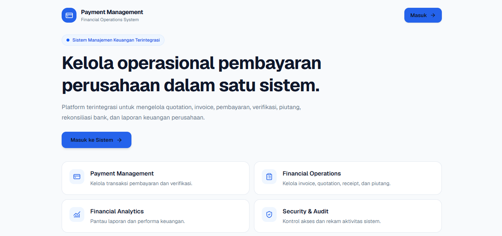
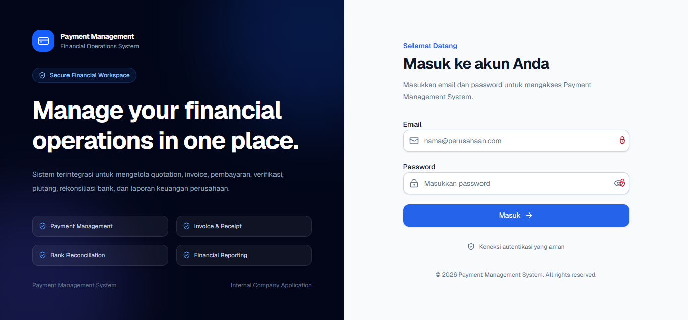
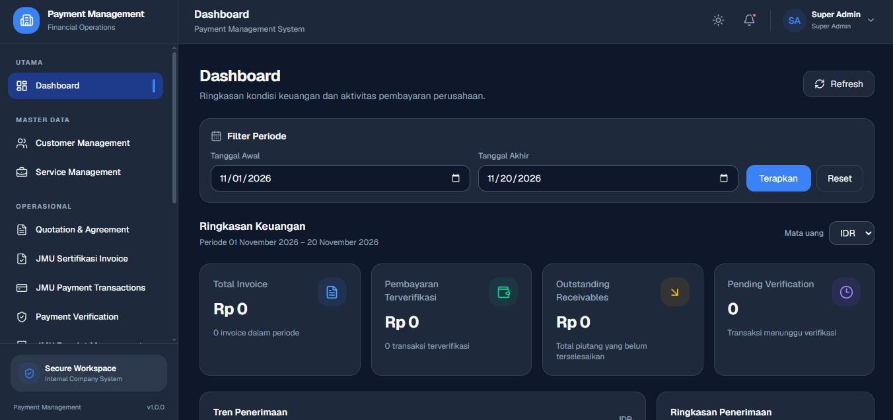
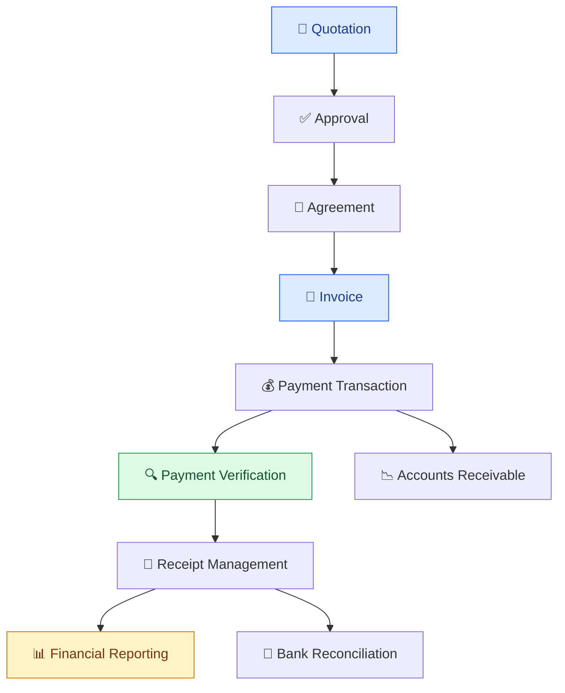
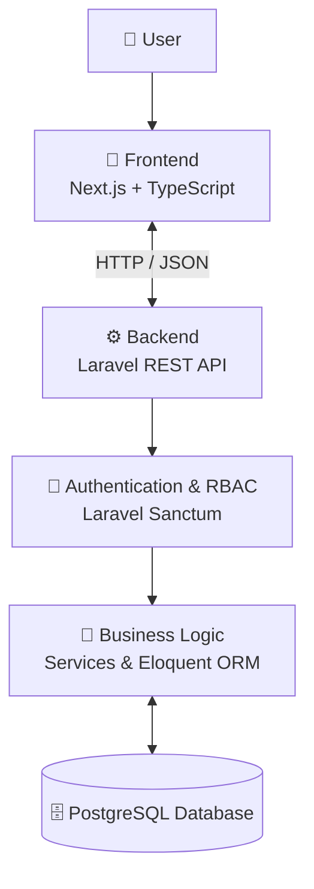

# 💳 Payment Management System

<p align="center">
  
  
</p>

<p align="center">
  <strong>Sistem Manajemen Pembayaran dan Administrasi Keuangan</strong>
  <br />
  Aplikasi berbasis web untuk mengelola proses administrasi keuangan dan pembayaran perusahaan secara terintegrasi.
</p>

<p align="center">
  <a href="#-tentang-proyek">Tentang</a> •
  <a href="#-fitur-utama">Fitur</a> •
  <a href="#-teknologi">Teknologi</a> •
  <a href="#-arsitektur-sistem">Arsitektur</a> •
  <a href="#-instalasi">Instalasi</a>
</p>

---

## 📸 Tampilan Aplikasi

<p align="center">
  
  <br />
  <em>Landing Page</em>
</p>
<br />
<p align="center">
  
  <br />
  <em>Login Page</em>
</p>
<br />
<p align="center">
  
  <br />
  <em>Dashboard Payment Management System</em>
</p>

---

## 📖 Tentang Proyek

**Payment Management System** merupakan aplikasi berbasis web yang dirancang untuk membantu perusahaan mengelola proses administrasi keuangan dan pembayaran secara terintegrasi.

Sistem ini mencakup pengelolaan penawaran harga (*quotation*), perjanjian kerja sama (*agreement*), invoice, transaksi pembayaran, verifikasi pembayaran, hingga pembuatan bukti pembayaran dan pelaporan keuangan.

Aplikasi dikembangkan untuk meningkatkan efisiensi proses administrasi, menjaga akurasi pencatatan transaksi, serta mempermudah pemantauan status pembayaran melalui satu sistem terpusat.

### 🎯 Tujuan Pengembangan

- Mengintegrasikan proses administrasi keuangan dalam satu platform.
- Mempermudah pengelolaan dokumen dan transaksi pembayaran.
- Meningkatkan akurasi pencatatan serta pemantauan piutang.
- Menyediakan informasi keuangan yang terstruktur dan mudah dianalisis.
- Meningkatkan keamanan data melalui pengaturan hak akses dan audit trail.

---

## ✨ Fitur Utama

Sistem memiliki 12 modul utama yang saling terintegrasi.

| No. | Modul | Deskripsi |
|:---:|---|---|
| 01 | 📊 Dashboard | Menampilkan ringkasan kondisi keuangan, statistik transaksi, invoice, pembayaran, dan piutang. |
| 02 | 📝 Quotation & Agreement | Mengelola penawaran harga, item layanan, persetujuan quotation, dan perjanjian kerja sama. |
| 03 | 🧾 JMU Sertifikasi Invoice | Mengelola penerbitan invoice, rincian tagihan, pajak, dan status pembayaran. |
| 04 | 💰 JMU Payment Transactions | Mencatat transaksi pembayaran pelanggan dan menghubungkannya dengan invoice. |
| 05 | 🔍 Payment Verification | Mengelola pemeriksaan dan verifikasi pembayaran berdasarkan nominal serta referensi transaksi. |
| 06 | 🧾 JMU Sertifikasi Receipt Management | Mengelola dan menerbitkan bukti penerimaan pembayaran. |
| 07 | 📉 Accounts Receivable | Memantau piutang, tagihan jatuh tempo, sisa pembayaran, dan aktivitas penagihan. |
| 08 | ↩️ JMU Refunds & Adjustments | Mengelola pengembalian dana, penyesuaian transaksi, dan proses persetujuannya. |
| 09 | 🏦 Bank Reconciliation | Mengelola rekening bank, mutasi rekening, serta pencocokan transaksi internal dengan data bank. |
| 10 | 📈 Financial Reports & Analytics | Menyajikan laporan dan analisis keuangan berdasarkan data transaksi dan periode tertentu. |
| 11 | 🛡️ JMU Audit Trail | Mencatat aktivitas pengguna, perubahan data, waktu, dan informasi terkait aktivitas sistem. |
| 12 | ⚙️ JMU Certification Payment Settings | Mengelola konfigurasi pembayaran, mata uang, format tanggal, dan penomoran dokumen. |

### 🔑 Key Features

- **Centralized Financial Management** — Pengelolaan administrasi keuangan dalam satu sistem terintegrasi.
- **Automated Document Numbering** — Penomoran quotation, agreement, invoice, payment, receipt, refund, dan adjustment secara otomatis.
- **Role-Based Access Control (RBAC)** — Pembatasan akses berdasarkan peran dan tanggung jawab pengguna.
- **Payment Verification** — Proses pemeriksaan dan verifikasi transaksi pembayaran.
- **Accounts Receivable Monitoring** — Pemantauan tagihan dan piutang pelanggan.
- **Bank Reconciliation** — Pencocokan transaksi internal dengan mutasi rekening bank.
- **Audit Trail** — Pencatatan aktivitas dan perubahan data untuk mendukung transparansi.
- **Financial Analytics** — Penyajian informasi keuangan melalui dashboard dan laporan.

---

## 🔄 Alur Proses Bisnis

Sistem dirancang untuk mendukung siklus administrasi pembayaran perusahaan dari awal hingga akhir.



---

## 👥 Hak Akses Pengguna

Sistem menerapkan **Role-Based Access Control (RBAC)** untuk membatasi akses berdasarkan tanggung jawab masing-masing pengguna.

| Role | Hak Akses |
|---|---|
| 👑 Super Admin | Mengelola seluruh modul dan konfigurasi sistem. |
| 🧑‍💼 Finance Manager | Mengawasi proses keuangan dan persetujuan transaksi. |
| 💼 Finance Staff | Mengelola invoice, pembayaran, piutang, dan administrasi keuangan. |
| 🤝 Sales Staff | Mengelola quotation dan data pelanggan. |
| 🔎 Auditor | Melakukan pemeriksaan data dan riwayat aktivitas sesuai hak akses. |

---

## 🛠️ Teknologi

Teknologi yang digunakan dalam pengembangan aplikasi:

### 🎨 Frontend

<p>
  
  
  
  
  
  
  
</p>

### ⚙️ Backend

<p>
  
  
</p>

### 🗄️ Database

<p>
  
</p>

### 🔧 Development Tools

<p>
  
  
  
  
  
</p>

---

## 🏗️ Arsitektur Sistem

Aplikasi menggunakan pendekatan **Modular Monolith Architecture** dengan pemisahan tanggung jawab antara frontend, backend, dan database.



### 📌 Komponen Arsitektur

| Komponen | Tanggung Jawab |
|---|---|
| Frontend | Menangani antarmuka, navigasi, visualisasi data, dan komunikasi API. |
| Backend | Menangani autentikasi, otorisasi, validasi, dan proses bisnis. |
| Services | Memisahkan logika bisnis dari controller agar lebih terstruktur. |
| Eloquent ORM | Mengelola interaksi antara aplikasi dan database. |
| PostgreSQL | Menyimpan seluruh data operasional dan transaksi. |
| Laravel Sanctum | Menangani autentikasi API. |

---

## 📂 Struktur Direktori

```text
payment_management/
│
├── frontend/
│   ├── app/
│   ├── components/
│   ├── features/
│   ├── hooks/
│   ├── lib/
│   ├── services/
│   └── types/
│
├── backend/
│   ├── app/
│   │   ├── Http/
│   │   ├── Models/
│   │   └── Services/
│   ├── database/
│   │   ├── migrations/
│   │   └── seeders/
│   ├── routes/
│   └── tests/
│
├── docs/
│   └── images/
│       └── dashboard.png
│
└── README.md
```

---

## 🚀 Instalasi

### 📋 Persyaratan Sistem

Pastikan perangkat telah memiliki:

- Node.js dan npm
- PHP
- Composer
- PostgreSQL
- Git

### 1️⃣ Clone Repository

```bash
git clone https://github.com/herzbay/payment_management.git
cd payment_management
```

### 2️⃣ Konfigurasi Backend

Masuk ke direktori backend:

```bash
cd backend
```

Install dependency:

```bash
composer install
```

Salin file konfigurasi:

```bash
cp .env.example .env
```

Generate application key:

```bash
php artisan key:generate
```

Atur koneksi PostgreSQL pada file `.env`:

```dotenv
DB_CONNECTION=pgsql
DB_HOST=127.0.0.1
DB_PORT=5432
DB_DATABASE=payment_management
DB_USERNAME=postgres
DB_PASSWORD=your_password
```

Sesuaikan konfigurasi akun administrator awal dengan environment variable yang digunakan oleh seeder.

Jalankan migration dan seeder:

```bash
php artisan migrate --seed
```

Jalankan backend:

```bash
php artisan serve
```

Backend berjalan pada:

`http://127.0.0.1:8000`

### 3️⃣ Konfigurasi Frontend

Buka terminal baru:

```bash
cd frontend
```

Install dependency:

```bash
npm install
```

Buat file `.env.local`:

```dotenv
BACKEND_URL=http://127.0.0.1:8000
```

Jalankan frontend:

```bash
npm run dev
```

Frontend dapat diakses melalui:

`http://localhost:3000`

---

## 🧪 Pengujian

Pengujian backend dilakukan menggunakan PHPUnit melalui Laravel Testing.

Jalankan perintah berikut dari direktori backend:

```bash
php artisan test
```

Pengujian API dapat dilakukan menggunakan Postman untuk memeriksa:

- 🔐 Autentikasi dan otorisasi pengguna.
- 📝 Validasi input dan pengelolaan data.
- 🔒 Pembatasan akses berdasarkan role.
- 💰 Proses pencatatan transaksi pembayaran.
- 📊 Konsistensi data dan proses bisnis.

---

## 🔐 Keamanan dan Integritas Data

Beberapa mekanisme diterapkan untuk menjaga keamanan dan konsistensi data:

- 🔐 **Authentication:** Menggunakan Laravel Sanctum untuk autentikasi API.
- 👥 **Authorization:** Menggunakan RBAC untuk mengatur hak akses pengguna.
- ✅ **Validation:** Memvalidasi input sebelum diproses oleh sistem.
- 🔄 **Database Transactions:** Menjaga konsistensi data dalam proses bisnis.
- 🔢 **Document Numbering:** Menghasilkan nomor dokumen secara otomatis dan terstruktur.
- 📋 **Audit Trail:** Mencatat aktivitas dan perubahan data.
- 💸 **Transaction Integrity:** Refund dan adjustment dicatat sebagai transaksi terpisah agar riwayat transaksi asli tetap terjaga.

---

## 👨‍💻 Pengembang

<p align="center">
  <strong>Bayu Herlambang</strong>
  <br />
  Full Stack Developer
  <br /><br />
  <a href="https://bayuherlambang.my.id">
    
  </a>
</p>

---

<p align="center">
  <strong>💳 Payment Management System</strong>
  <br />
  <em>Integrated Financial and Payment Management Solution</em>
  <br /><br />
  Dibangun untuk mendukung pengelolaan administrasi keuangan perusahaan yang lebih efisien, terstruktur, dan transparan.
</p>
